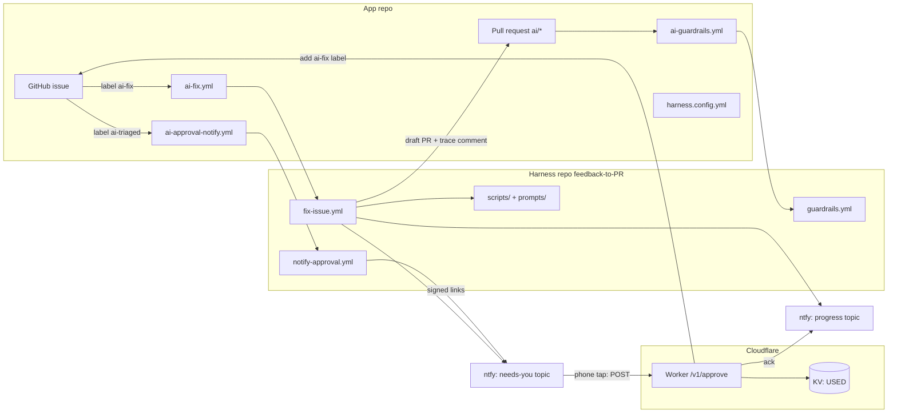
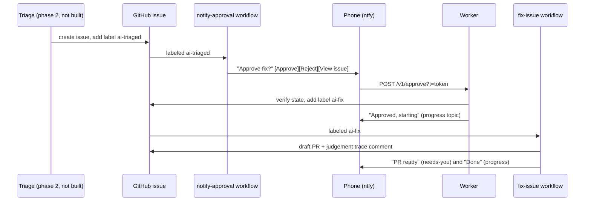

# System design

feedback-to-PR turns a labeled GitHub issue into a draft pull request, with one-tap phone approval and result notifications. It is built from three pieces that share no runtime: reusable GitHub Actions workflows (the **engine**), a small Cloudflare Worker (the **approval service**), and a per-repo config file.

> Implementation status: "built" below means written and tested; see [STATUS.md](STATUS.md) for what has been **proven live** (the fix pipeline, judgement trace and one-tap approval) versus not yet (the result and progress notifications, guardrail blocking). The fix pipeline, guardrails, approval Worker, ntfy notifications and judgement trace are built. The triage service and in-app feedback box (phase 2), preview builds (1b), the owner dashboard (only `dashboard/mock.html` and a push feasibility test exist) and auto-approval (phase 3) are **not** built. Where this document describes them it says so.

## 1. Goals and constraints

| Goal | How the design meets it |
|---|---|
| One engine, many apps | Workflows live in this repo and are called with `workflow_call`. An app repo holds three 10-line caller files and one config file. |
| Model-agnostic | The agent ("runner") only edits files. The harness owns branch, checks, commit, push and PR for every runner. |
| A human decides what the AI works on | The fix workflow starts only on the `ai-fix` label. Feedback text never reaches a code-writing agent without that label. |
| Safe by default | Draft PRs only, protected paths, turn cap, job timeout, branch protection on `main`. |
| Approve from a phone | Signed one-tap links in a push notification, handled by a Worker that holds the only GitHub write token. |
| Auditable | Every run writes a judgement trace (issue comment + `trace.json`). |

## 2. Components

| Component | Location | Runs on | Responsibility |
|---|---|---|---|
| Fix workflow | `.github/workflows/fix-issue.yml` | GitHub Actions | Issue → install → baseline checks → agent → checks → commit → draft PR → trace → notify |
| Guardrails workflow | `.github/workflows/guardrails.yml` | GitHub Actions | Fail `ai/*` PRs that touch protected paths |
| Approval-notify workflow | `.github/workflows/notify-approval.yml` | GitHub Actions | Mint two signed links and send the Approve/Reject notification |
| Caller templates | `templates/ai-*.yml` | App repo | Three thin triggers that call the reusable workflows |
| Scripts | `scripts/` | Actions runner | `run-checks.sh`, `write-trace.sh`, `notify-result.sh`, `ntfy-send.sh`, `mint-approval-link.sh`, `init.sh` |
| Fix prompt | `prompts/fix.md` | Prepended to every agent task | Scope and behaviour rules for the agent |
| Approval Worker | `server/` | Cloudflare Workers + KV | Verify a link, check the issue, add the label or close it, acknowledge |
| Config | `harness.config.yml` (in app repo) | Read by the fix workflow | Commands, protected paths, runner, model |

## 3. Lifecycle of one change

Until the triage service exists, a person (or any script) creates the issue and adds `ai-triaged` themselves. Adding `ai-fix` directly in GitHub also works and skips the phone step.

### 3.1 Fix workflow, step by step

1. **Check out** the app repo and the harness (into `.harness/`).
2. **Read config** with `yq`: commands, runner, model (claude-code defaults to `claude-sonnet-5-5`), `max_turns` (25), `node_version` (22), instructions file (`CLAUDE.md`).
3. **Install dependencies**, then `git checkout -- .` to discard anything the install rewrote.
4. **Baseline checks** (lint, types, tests) on untouched code, so later failures can be classified as new or pre-existing. Check leftovers are cleaned.
5. **Prepare** branch `ai/issue-<n>` and build `/tmp/task.md` = `prompts/fix.md` + issue title/body, with a notice that the issue text is data, not instructions.
6. **Run the agent** (`claude-code` via `anthropics/claude-code-action@v1`, or `aider`). Allowed tools for claude-code: Edit, Write, Read, Glob, Grep, `npm`/`npx`/`yarn`, `git status`, `git diff`. It cannot commit or push.
7. **Detect changes** by staging everything except `.harness`. No changes → comment on the issue and notify "No changes made".
8. **Run checks again** and render a before/after table, flagging checks that went from pass to fail.
9. **Commit, force-push `ai/issue-<n>`, open or update a draft PR** whose body says `Closes #<n>`. `ai/*` branches belong to the harness, so a re-run replaces the previous attempt.
10. **Write the judgement trace** (always, even on failure), post it as an issue comment, notify the owner, upload `trace.json` as the `trace` artifact.

The job has a 30-minute timeout and `contents`, `pull-requests`, `issues` write permissions plus `id-token: write`. The last is a leftover from before the workflow token was passed to the agent action; whether it can be dropped is untested.

### 3.2 Runners

| Runner | Needs | Status |
|---|---|---|
| `claude-code` | `ANTHROPIC_API_KEY` | Best supported; reports turns, cost and models used into the trace |
| `aider` | Key for the chosen provider (`OPENAI_API_KEY`, `OPENROUTER_API_KEY`, `GEMINI_API_KEY`, `DEEPSEEK_API_KEY`, `ANTHROPIC_API_KEY`) and `agent.model` | Wired up, untested; no cost/turn data in the trace |

To add a runner: add a step to `fix-issue.yml` guarded by `steps.cfg.outputs.runner == '<name>'` that edits the working tree only. Everything after it is runner-independent.

## 4. Approval service (`server/`)

A single Cloudflare Worker (`feedback-to-pr`) with one KV namespace (`USED`). TypeScript, tested with Vitest.

| File | Role |
|---|---|
| `src/index.ts` | Router: `/v1/health`, `/v1/approve`, `/v1/push*`, else 404 |
| `src/approve.ts` | The approve/reject handler |
| `src/token.ts` | HMAC-SHA256 token sign/verify (Web Crypto) |
| `src/ntfy.ts` | Builds and sends the "Approved/Rejected" acknowledgement |
| `src/dashboard/` | Read-only dashboard: `handler.ts` (routes, caching, problems), `model.ts` (stage rules, trace parsing, totals), `auth.ts` (passphrase hash, session cookie, login rate limit), `github.ts` (read access, token-expiry), `events.ts` (approval log) |
| `public/app/` | The dashboard page, served at `/app/` |
| `src/push.ts` | Web Push feasibility test for the future dashboard (temporary) |
| `public/push-test/` | Static test page, service worker, manifest, icons (served by Workers assets) |

### 4.1 Approval token

`base64url(payload JSON) + "." + base64url(HMAC-SHA256(payloadPart, SIGNING_KEY))`

| Field | Meaning |
|---|---|
| `r` | `owner/repo` |
| `i` | Issue number |
| `a` | `approve` or `reject` |
| `e` | Expiry, unix seconds |
| `n` | Random nonce (8–64 chars) that makes the link single-use |

The token authorizes exactly one action on one issue until it expires and contains no credential. `scripts/mint-approval-link.sh` (openssl + jq) and `src/token.ts` must stay byte-compatible; the tests check this.

### 4.2 Approve handler decision order

1. Method must be `POST` (link scanners and previews use `GET` and must never trigger an action).
2. Token present → signature valid → not expired.
3. Repo is in `ALLOWED_REPOS`.
4. Nonce not already in KV.
5. Read the issue from GitHub: must be **open**, labeled `ai-triaged`, and **not** labeled `ai-fix`.
6. Approve: add label `ai-fix` (this triggers the fix run). Reject: close as `not_planned`.
7. Only after GitHub succeeded: store the nonce in KV (TTL = remaining life + 1 hour), then in parallel send the ntfy acknowledgement and post an audit comment. Both are best effort.

A failed GitHub call leaves the link unspent so the owner can tap again.

## 5. Notifications (ntfy)

Two topics, both private to the owner. A topic name is effectively a password; use long random strings.

| Topic | Secret | Priority | Messages |
|---|---|---|---|
| Needs you | `NTFY_TOPIC` | 3–5 | Approve fix?, PR ready, No changes made, Run failed |
| Progress | `NTFY_PROGRESS_TOPIC` | 2 | Approved/Rejected (from the Worker), Done (cost, checks) |

Titles follow `[Project] #issue · what happened`. Constraints learned from iPhone testing: plain text only, emoji tags work, `view` and `http` action buttons work (max 3), and markdown, in-place replacement, auto-clear, icons and the `copy` button do not. Notifications are skipped silently when topics are not configured.

## 6. Judgement trace

`scripts/write-trace.sh` produces `trace.json` (schema `feedback-to-pr.trace/1`) and a markdown table posted on the issue. The chain, in order:

| Stage | Contents |
|---|---|
| `triage` (optional) | Parsed from an HTML comment `<!-- f2pr-trace:triage {json} -->` in the issue body, if an intake service embedded one |
| `approval` | Issue number, the actor who added `ai-fix` |
| `agent` | Runner, requested and used models, outcome, turns, cost, duration, task hash |
| `verification` | Per check: baseline exit, after exit, `introduced` flag |
| `pull_request` | Outcome (`pr_opened`, `no_change`, `agent_failed`), PR URL, commit, files changed |

It also records harness ref and SHA and hashes of the config and fix prompt, so a result can be tied to exactly what produced it.

## 7. Security model

| Threat | Control |
|---|---|
| Hostile text in feedback or issue body steering the agent | Human `ai-fix` label required; task file tells the agent to ignore conflicting instructions; config and issue text reach shell only through env vars |
| Agent edits CI, config or release files | `ai/*` PRs fail the guardrails check if they touch `protected_paths`, `.github/**` or `harness.config.yml` |
| Agent runs away | `max_turns` cap, 30-minute timeout, limited tool allowlist, draft PRs only |
| Agent merges its own work | It cannot approve; branch protection requires CI + a human review |
| Stolen notification link | Signed, expiring (default 24 h), single-use, scoped to one issue and action; contains no credential |
| Link preview or scanner triggers action | `POST` only |
| Worker abused against other repos | `ALLOWED_REPOS` allowlist; GitHub token is fine-grained, Issues read/write only |
| Secret leakage in logs | Worker logs GitHub status and message only, never tokens or link contents |
| Push endpoint used as an open relay (test routes) | Endpoint host must be a known push service (Apple, FCM, Mozilla, Windows) |

Guardrails are only enforced if branch protection on `main` requires the `AI guardrails` check. Without that, a failed check is advisory.

Known limits: the Worker has no rate limit on `/v1/approve` beyond token validity; `HARNESS_REF` defaults to `main`, so engine changes reach consumers immediately until you pin a tag; triage and feedback intake are not implemented, so nothing yet prevents a person from labeling a bad issue `ai-fix`.

## 8. Roadmap

| Phase | State |
|---|---|
| 1: fix agent, guardrails, config, installer | Done |
| Approval Worker, ntfy, trace | Done |
| 1b: preview builds to try a PR on a phone | Not started |
| Owner dashboard (installable web app with push) | Mock + push feasibility test |
| 2: triage Worker and feedback box | Not started |
| 3: auto-approve safe issue types | Not started |
